# CYBER FORENSIC EVIDENCE SEARCH

**Ekstraksi • Pencarian • Pengamanan Bukti Digital — offline, read-only, dan teraudit**

> **Dibuat oleh: Alfin Aqila Muzaki**
> Sumber resmi: <https://github.com/AlfinAqilaMuzaki/forensic_evidence_search>

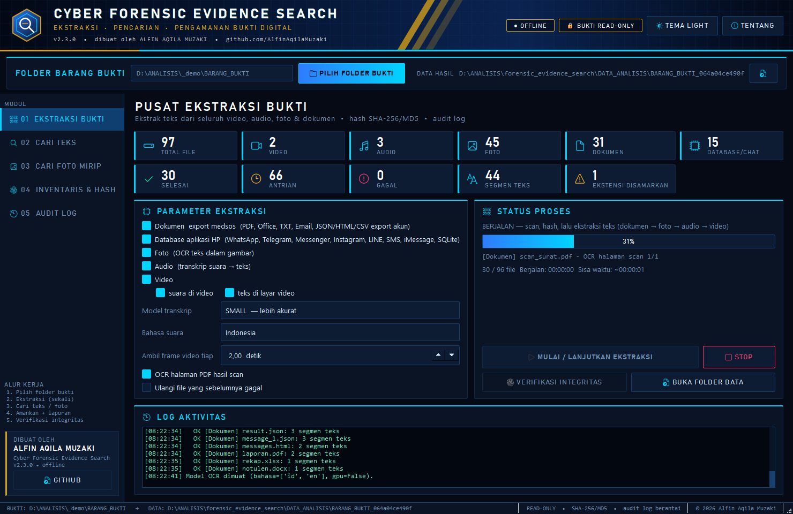

Aplikasi desktop forensik digital untuk Windows. Aplikasi ini **membaca seluruh
isi folder barang bukti** (video, audio, foto, dan dokumen dalam jumlah ribuan
hingga ratusan ribu file), **mengubah semua ucapan dan tulisan di dalamnya menjadi
teks yang bisa dicari**, lalu menunjukkan **di file mana, pada detik ke berapa
atau halaman berapa** sebuah kalimat muncul. Temuan bisa langsung **diamankan**:
salinan bukti diverifikasi hash, lalu dibuatkan laporan **PDF/HTML/CSV ber-watermark**
yang siap dilampirkan.

Aplikasi ini juga punya modul **Cari Foto Mirip**. Dengan satu foto referensi,
modul ini menemukan foto yang sama atau mirip di dalam folder bukti, walaupun foto
itu sudah di-crop, di-resize, dikompres, di-screenshot, diberi watermark, atau
diganti namanya.

> **Versi:** 2.3.0 &nbsp;•&nbsp; **Platform:** Windows 10/11 64-bit &nbsp;•&nbsp;
> **Mode:** 100% offline (tidak ada data yang dikirim ke internet) &nbsp;•&nbsp;
> **Pembuat:** Alfin Aqila Muzaki

---

## ⬇️ Download & Instal — langsung pakai, tanpa Python

Untuk pengguna yang **hanya ingin memakai aplikasinya**. Tidak perlu menginstal Python,
library, model AI, atau FFmpeg, karena semuanya sudah ada di dalam installer.

**1. Download** dari halaman Releases:
**<https://github.com/AlfinAqilaMuzaki/forensic_evidence_search/releases/latest>**

Di bagian **Assets**, unduh **SEMUA** file installer, lalu simpan **di folder yang sama**:

| File | Keterangan |
|---|---|
| `CyberForensicEvidenceSearch-Setup-v<versi>.exe` | Installer (jalankan file ini) |
| `CyberForensicEvidenceSearch-Setup-v<versi>-1.bin` | Data installer berisi library & model AI (± 1,6 GB). Wajib diunduh |

> Installer dipecah menjadi `Setup.exe` + file `.bin` karena GitHub membatasi ukuran
> per file maksimal 2 GB. Pengguna tetap cukup menjalankan `Setup.exe`, asalkan file
> `.bin` berada di folder yang sama. Total unduhan ± 1,6 GB.

**2. Instal**
1. Double-click `CyberForensicEvidenceSearch-Setup-v<versi>.exe`.
2. Jika muncul layar biru **"Windows protected your PC"** (SmartScreen), klik
   **More info** lalu **Run anyway**. Peringatan ini muncul karena installer belum
   memiliki sertifikat tanda tangan digital berbayar, bukan karena berbahaya.
   Sumber resmi installer hanya repository di atas.
3. Klik **Lanjut**. Di halaman lokasi instalasi, Anda boleh memilih drive lain yang
   ruangnya lebih lega (contoh `D:\Cyber Forensic Evidence Search`).
4. Pastikan **Buat ikon di Desktop** tercentang, lalu klik **Lanjut**, **Pasang**, dan **Selesai**.
   Instalasi tidak memerlukan hak administrator.

**3. Pakai**
Buka aplikasi lewat ikon **Cyber Forensic Evidence Search** di **Desktop** atau di
**menu Start**. Selanjutnya ikuti [Cara menggunakan](#8-cara-menggunakan).

| Kebutuhan | Keterangan |
|---|---|
| Sistem operasi | Windows 10 / 11 64-bit |
| Ruang disk | ± 3 GB untuk aplikasi, ditambah ruang untuk data hasil analisis |
| RAM | Minimal 8 GB (disarankan 16 GB) |
| Internet | **Tidak perlu**, aplikasi berjalan 100% offline |
| Laporan PDF | Memakai Microsoft Edge (sudah ada di Windows 10/11) |

**Uninstall:** *Settings → Apps → Installed apps → Cyber Forensic Evidence Search → Uninstall*.
Folder `DATA_ANALISIS` (hasil analisis dan paket bukti) **tidak** ikut terhapus, supaya
tidak ada bukti yang hilang. Hapus folder itu secara manual bila sudah tidak diperlukan.

> Ingin menjalankan dari source code atau ikut mengembangkan? Lihat
> [Instalasi dari GitHub](#7-instalasi-dari-github-langkah-demi-langkah).

---

## Daftar Isi

1. [Latar belakang & masalah yang diselesaikan](#1-latar-belakang--masalah-yang-diselesaikan)
2. [Keuntungan & manfaat](#2-keuntungan--manfaat)
3. [Fitur utama](#3-fitur-utama)
4. [Format file yang didukung](#4-format-file-yang-didukung)
5. [Prinsip forensik: integritas & keamanan bukti](#5-prinsip-forensik-integritas--keamanan-bukti)
6. [Persyaratan sistem](#6-persyaratan-sistem)
7. [Instalasi dari GitHub (langkah demi langkah)](#7-instalasi-dari-github-langkah-demi-langkah)
8. [Cara menggunakan](#8-cara-menggunakan)
9. [Cara melihat & membaca hasil](#9-cara-melihat--membaca-hasil)
10. [Kinerja & skala (hasil pengukuran)](#10-kinerja--skala-hasil-pengukuran)
11. [Tema tampilan](#11-tema-tampilan)
12. [Membuat versi EXE & installer (untuk developer)](#12-membuat-versi-exe--installer-untuk-developer)
13. [Pengujian](#13-pengujian)
14. [Struktur project](#14-struktur-project)
15. [Pemecahan masalah (FAQ)](#15-pemecahan-masalah-faq)
16. [Batasan yang perlu diketahui](#16-batasan-yang-perlu-diketahui)
17. [Lampiran: cara kerja teknis](#17-lampiran-cara-kerja-teknis)
18. [Pembuat & sumber resmi](#18-pembuat--sumber-resmi)

---

## 1. Latar belakang & masalah yang diselesaikan

Dalam penanganan perkara siber, penyidik dan pemeriksa forensik sering menerima
hasil ekstraksi perangkat (ponsel, laptop, flashdisk, cloud) yang berisi
**ribuan video, rekaman suara/voice note, screenshot, foto, dan dokumen**.
Tugasnya sering kali spesifik, misalnya:

> *"Temukan bukti di mana ada ucapan atau tulisan **'hay tolong lakukan penyerangan itu'**."*

Tanpa alat bantu, kalimat itu harus dicari secara manual: setiap video ditonton,
setiap rekaman diputar, setiap foto dibuka, dan setiap dokumen dibaca satu per satu.
Untuk ribuan file, pekerjaan ini bisa memakan **berminggu-minggu**, sangat
melelahkan, dan rawan terlewat.

**Cyber Forensic Evidence Search** mengotomatiskan pekerjaan itu:

| Tanpa aplikasi ini | Dengan aplikasi ini |
|---|---|
| Menonton/memutar setiap video & audio satu per satu | Semua ucapan ditranskrip otomatis menjadi teks bertimestamp |
| Membuka setiap foto/screenshot dan membaca tulisannya | Semua tulisan di foto & frame video dibaca otomatis (OCR) |
| Membuka setiap PDF/Word/Excel | Isi seluruh dokumen diindeks, termasuk PDF hasil scan |
| Mencatat lokasi temuan secara manual | Lokasi otomatis: **nama file + detik/halaman + cuplikan** |
| Menyalin bukti & menghitung hash secara manual | Satu klik: salinan + verifikasi hash + laporan HTML/CSV |
| Sulit membuktikan bukti tidak diubah | Hash SHA-256/MD5 + audit log berantai hash |

---

## 2. Keuntungan & manfaat

- **Hemat waktu secara drastis.** Ekstraksi dijalankan sekali (bisa ditinggal
  semalaman). Setelah itu setiap pencarian kalimat di ratusan ribu potongan teks
  hanya butuh **hitungan detik**.
- **Tidak ada yang terlewat.** Seluruh file diproses secara sistematis, bukan sampel.
  Pencarian *fuzzy* tetap menemukan kalimat walaupun hasil transkrip/OCR tidak
  sempurna (contoh: "hai/hey/hay", "to long" = "tolong").
- **Langsung ke titik bukti.** Hasil menunjukkan detik tepat di video/audio. Tombol
  **PUTAR DI DETIK INI** memutar rekaman 2 detik sebelum kalimat diucapkan, jadi
  verifikasi manual cukup beberapa detik per temuan.
- **Menjaga integritas barang bukti.** Folder bukti hanya dibaca (read-only). Setiap
  file di-hash sebelum diproses, dan setiap aksi tercatat dalam audit log yang tidak
  bisa diubah diam-diam.
- **Siap untuk administrasi penyidikan.** Paket bukti berisi salinan file
  (hash terverifikasi), cuplikan frame, teks hasil ekstraksi, manifest hash, dan
  laporan HTML/CSV yang bisa dicetak atau dilampirkan.
- **Mendeteksi upaya penyamaran.** File yang ekstensinya diganti (contoh: foto JPG
  diberi nama `.dat`) tetap dikenali dari isi filenya dan ditandai.
- **Aman untuk data sensitif.** Semua model AI berjalan lokal. Tidak butuh internet
  dan tidak ada data bukti yang keluar dari komputer.
- **Mudah digunakan.** Alurnya terpandu (01 → 05), tidak perlu mengisi formulir kasus,
  cukup pilih folder bukti. Tersedia dua tema tampilan.
- **Satu alat untuk dua kebutuhan.** Pencarian teks lintas media **dan** pencarian
  foto mirip ada dalam satu aplikasi.

---

## 3. Fitur utama

| Modul | Fungsi |
|---|---|
| **01 Ekstraksi Bukti** | Scan seluruh folder bukti, hitung hash SHA-256 + MD5, lalu ekstrak teks: transkrip suara (video & audio), OCR teks di foto dan di frame video, isi dokumen (termasuk OCR PDF scan), serta **pesan chat & media sosial**: WhatsApp, Telegram, Facebook, Messenger, Instagram, Threads, Twitter/X, Discord, TikTok, Snapchat, LINE, Skype, Google Chat, LinkedIn, SMS, dan iMessage (dari export akun maupun database aplikasi di HP). Ada statistik live, progres, perkiraan sisa waktu, log, STOP/lanjutkan, dan verifikasi integritas. |
| **02 Cari Teks** | Cari kalimat di semua hasil ekstraksi dengan tiga mode (Fuzzy, Frasa persis, Semua kata) dan filter jenis file. Panel detail menampilkan pratinjau frame/foto, teks lengkap dengan highlight, path, hash, dan tombol putar di detik temuan. Pesan chat menampilkan **tanggal-jam, nama chat, dan pengirim**. Voice note/foto/video menampilkan **di chat mana dan oleh siapa file itu dikirim**. |
| **03 Cari Foto Mirip** | Index visual sekali per folder bukti, lalu cari dengan foto referensi (pilih atau seret). Ada rincian skor CLIP / pHash / ORB dan penilaian otomatis (foto sama vs mirip). |
| **Amankan + Laporan** | Untuk hasil teks maupun foto: salinan file asli read-only dengan verifikasi hash, frame, teks, **`laporan.pdf`** dan `laporan.html` (ber-watermark logo + teks transparan, kode verifikasi SHA-256, nomor halaman), `hasil_pencarian.csv`, `manifest_hash.txt`, `manifest_paket.sha256`. |
| **04 Inventaris & Hash** | Daftar seluruh file bukti: jenis, status, jumlah segmen teks, ukuran, cara deteksi tipe, SHA-256, MD5. Bisa difilter dan di-export ke CSV. |
| **05 Audit Log** | Semua aksi tercatat otomatis (operator = user Windows) dengan rantai hash. Ada tombol verifikasi rantai. |

---

## 4. Format file yang didukung

| Jenis | Ekstensi | Cara ekstraksi teks |
|---|---|---|
| **Video** | mp4, mkv, avi, mov, wmv, flv, webm, 3gp, m4v, mpg, mpeg, ts, mts, vob, ogv | Transkrip suara (Whisper) + OCR teks di layar (frame diambil tiap N detik, frame yang sama dilewati) |
| **Audio** | mp3, wav, m4a, aac, ogg, **opus (voice note WhatsApp)**, flac, wma, **amr**, aiff | Transkrip suara bertimestamp (Whisper) |
| **Foto** | jpg, jpeg, jfif, png, bmp, gif, tif, tiff, webp | OCR (EasyOCR, huruf latin / bahasa Indonesia) |
| **Dokumen** | pdf, docx, doc, xlsx, xls, pptx, ppt, odt, ods, odp, rtf, txt, log, csv, tsv, json, xml, html, md, **eml (email)**, srt, vtt | Pembacaan teks langsung. Halaman PDF hasil scan di-OCR. **Export chat WhatsApp (.txt)** dipecah per pesan |
| **Export media sosial** | json, html, csv, xml, js (Twitter/X) dari "Download your information" / "Export chat" | Dikenali otomatis per platform, lalu dipecah per pesan/postingan/komentar (lihat [8.9](#89-media-sosial--aplikasi-pesan-lain)) |
| **Database / Chat** | db, sqlite, sqlite3, db3 (dan file SQLite tanpa ekstensi): WhatsApp `msgstore.db` & `ChatStorage.sqlite`, Telegram `cache4.db`, Messenger `threads_db2`, Instagram `direct.db`, LINE `naver_line`, SMS `mmssms.db`, iMessage `sms.db`, database aplikasi lain | Pesan per baris (tanggal, chat, pengirim, isi, media). Database lain: semua kolom teks per baris tabel, termasuk teks di dalam kolom biner (BLOB) |

File **tanpa ekstensi atau berekstensi palsu** dikenali dari *signature* (magic
bytes) isinya, lalu ditandai **"DISAMARKAN"** di Inventaris.

Bahasa transkrip suara: **Indonesia** (default), Inggris, Jawa, Melayu, Sunda, atau deteksi otomatis.

---

## 5. Prinsip forensik: integritas & keamanan bukti

1. **Read-only.** Folder bukti hanya dibaca. Aplikasi tidak pernah menulis,
   memindahkan, mengganti nama, atau menghapus file di dalamnya. Ini diuji otomatis
   (`tests/validate_forensic.py` membandingkan seluruh file sebelum dan sesudah proses).
   Aplikasi juga **menolak** dijalankan bila folder aplikasinya berada di dalam folder bukti.
2. **Hash sebelum proses.** Setiap file di-hash **SHA-256 dan MD5** sebelum diekstrak.
   Hash ini dicantumkan di setiap hasil pencarian, inventaris, dan laporan.
3. **Verifikasi integritas.** Tombol **VERIFIKASI INTEGRITAS** menghitung ulang hash
   semua file bukti dan membandingkannya dengan hash awal. File yang berubah atau hilang dilaporkan.
4. **Audit log berantai hash.** Setiap aksi (buka folder bukti, scan, ekstraksi,
   pencarian, pengamanan, verifikasi, export) dicatat dengan waktu, operator, dan
   detail. Setiap entri memuat hash entri sebelumnya (*hash chain*), sehingga
   penghapusan atau perubahan satu baris log **langsung terdeteksi**.
5. **Salinan bukti terverifikasi.** Saat diamankan, file disalin dengan timestamp
   asli dipertahankan, hash salinan dihitung dan dibandingkan dengan hash asli
   (status COCOK/TIDAK COCOK), lalu salinan diberi atribut read-only. Seluruh isi
   paket di-hash ke `manifest_paket.sha256`.
6. **Offline.** Model AI (Whisper, EasyOCR, CLIP) berjalan lokal dari folder `models/`.
7. **Data hasil terpisah.** Semua hasil analisis disimpan di
   `DATA_ANALISIS/<nama-folder>_<hash-path>/` di samping aplikasi, tidak pernah di
   folder bukti dan tidak di drive C:.

---

## 6. Persyaratan sistem

| Komponen | Minimum | Disarankan |
|---|---|---|
| Sistem operasi | Windows 10 64-bit | Windows 11 64-bit |
| CPU | 4 core | 8 core atau lebih (proses transkrip & OCR memakai semua core) |
| RAM | 8 GB | 16 GB atau lebih |
| Ruang disk | ± 8 GB (library + model) | SSD, plus ruang untuk data hasil (± 1–5% dari ukuran bukti) |
| Python | 3.10 | **3.11** (terverifikasi 3.11.8) |
| Lainnya | Git, FFmpeg | — |

> Internet hanya dibutuhkan **sekali** saat instalasi (mengunduh library & model).
> Setelah itu aplikasi berjalan sepenuhnya offline.

---

## 7. Instalasi dari GitHub (langkah demi langkah)

> Contoh perintah memakai **PowerShell** atau **Command Prompt**.
> Repository: <https://github.com/AlfinAqilaMuzaki/forensic_evidence_search>

### Langkah 1 — Install Python 3.11

1. Unduh dari <https://www.python.org/downloads/windows/> (pilih *Windows installer 64-bit*, versi 3.11.x).
2. Saat instalasi, **centang "Add python.exe to PATH"**, lalu klik *Install Now*.
3. Cek di terminal:
   ```powershell
   python --version
   ```
   Hasil yang diharapkan: `Python 3.11.x`.

### Langkah 2 — Install Git

Unduh dari <https://git-scm.com/download/win> dan install dengan pengaturan default. Cek:
```powershell
git --version
```

### Langkah 3 — Install FFmpeg (wajib untuk video & audio)

FFmpeg dipakai untuk membaca video/audio dan untuk memutar rekaman di detik temuan (`ffplay`).

**Cara A (paling mudah, Windows 10/11):**
```powershell
winget install Gyan.FFmpeg
```
Tutup lalu buka lagi terminal, kemudian cek:
```powershell
ffmpeg -version
```

**Cara B (manual / komputer tanpa winget):** unduh *ffmpeg-release-essentials.zip* dari
<https://www.gyan.dev/ffmpeg/builds/>, extract, lalu salin `ffmpeg.exe`, `ffprobe.exe`,
dan `ffplay.exe` ke folder **`bin\`** di dalam folder aplikasi (buat foldernya bila
belum ada). Aplikasi otomatis mencari di `bin\` terlebih dahulu.

### Langkah 4 — Clone repository

```powershell
cd D:\
git clone https://github.com/AlfinAqilaMuzaki/forensic_evidence_search.git
cd forensic_evidence_search
```

> Simpan di drive dengan ruang kosong yang cukup (contoh `D:\`), karena data hasil
> analisis disimpan di samping aplikasi.

### Langkah 5 — Buat virtual environment (disarankan)

Supaya library aplikasi ini tidak bentrok dengan tool Python lain di komputer yang sama:
```powershell
python -m venv .venv
.venv\Scripts\activate
python -m pip install --upgrade pip
```
Bila berhasil, awal baris terminal akan berubah menjadi `(.venv)`.

### Langkah 6 — Install library

```powershell
pip install -r requirements.txt
```
Proses ini mengunduh ± 2–3 GB (PyTorch, OpenCV, PySide6, EasyOCR, faster-whisper, dll)
dan bisa memakan 10–30 menit tergantung koneksi.

> **Opsional (GPU NVIDIA):** untuk mempercepat OCR & foto mirip, install PyTorch versi
> CUDA sesuai petunjuk <https://pytorch.org/get-started/locally/>. Tanpa GPU, aplikasi
> tetap berjalan normal di CPU.

### Langkah 7 — Unduh model AI (sekali saja)

Model tidak disimpan di GitHub karena ukurannya besar. Jalankan:
```powershell
python scripts\download_model.py
```

| Model | Fungsi | Ukuran |
|---|---|---|
| CLIP ViT-B-32 | Pencarian foto mirip | ± 580 MB |
| faster-whisper `base` + `small` | Transkrip suara | ± 145 MB + ± 480 MB |
| EasyOCR (CRAFT + latin + english) | OCR foto & frame video | ± 115 MB |

Gunakan `python scripts\download_model.py --no-small` untuk melewati model `small`
(hemat ± 480 MB, transkrip memakai model `base`).

Setelah selesai akan muncul tulisan `SELESAI. Semua model tersimpan di folder models/`.

### Langkah 8 — Jalankan aplikasi

```powershell
python main.py
```
atau **double-click `jalankan.bat`** (tanpa venv), atau buat shortcut berisi
`.venv\Scripts\pythonw.exe main.py` (dengan venv, tanpa jendela konsol).

Cek cepat tanpa membuka tampilan (memeriksa folder data, FFmpeg, browser PDF, CLIP, EasyOCR, dan Whisper; semua harus `[OK]`):
```powershell
python main.py --selftest
```

### Langkah 9 — Uji instalasi dengan data contoh (opsional, disarankan)

```powershell
python tests\make_forensic_dataset.py D:\uji\bukti
python tests\validate_forensic.py D:\uji\bukti D:\uji\hasil small
```
Bila instalasi benar, baris terakhir menampilkan **`HASIL: LULUS`**.

---

## 8. Cara menggunakan

Alur kerja lengkap ada di panel kiri aplikasi:
**Pilih folder bukti → Ekstraksi (sekali) → Cari teks/foto → Amankan + laporan → Verifikasi integritas.**

### 8.1 Pilih folder barang bukti

Klik **PILIH FOLDER BUKTI** di bar atas, lalu arahkan ke folder hasil ekstraksi
perangkat (boleh berisi subfolder bertingkat).

- Kolom **DATA HASIL** menunjukkan lokasi penyimpanan hasil analisis untuk folder itu
  (dibuat otomatis, tidak perlu folder kasus atau nomor kasus).
- Folder bukti terakhir otomatis dibuka kembali saat aplikasi dijalankan lagi.
- Chip **OFFLINE** dan **BUKTI READ-ONLY** di header menandakan mode kerja aman.

### 8.2 Ekstraksi bukti (modul 01)


1. **Parameter ekstraksi**
   - Centang jenis file yang diproses: Dokumen, Foto, Audio, Video
     (untuk video bisa dipilih *suara di video* dan/atau *teks di layar video*).
   - **Model transkrip:** `SMALL` (lebih akurat, disarankan untuk bukti) atau `BASE` (lebih cepat).
   - **Bahasa suara:** Indonesia (default) atau bahasa lain/otomatis.
   - **Ambil frame video tiap:** 2 detik (default). Perbesar (contoh 4–5 detik) untuk
     mempercepat video panjang, perkecil untuk teks yang muncul sangat singkat.
   - **OCR halaman PDF hasil scan:** membaca PDF yang berupa gambar.
   - **Ulangi file yang sebelumnya gagal:** mencoba ulang file yang error di proses sebelumnya.
2. Tekan **MULAI / LANJUTKAN EKSTRAKSI**.
3. Pantau proses:
   - **Kartu statistik:** total file per jenis, selesai, antrian, gagal, jumlah segmen
     teks, dan jumlah file berekstensi disamarkan.
   - **Status proses:** progres %, file yang sedang diproses, waktu berjalan, perkiraan sisa waktu.
   - **Log aktivitas:** catatan per file (jumlah segmen teks yang ditemukan, error bila ada).
4. **STOP** bisa ditekan kapan saja. Progres tersimpan, dan saat **MULAI** ditekan lagi
   proses melanjutkan file yang belum selesai (file yang sudah selesai tidak diulang).
   Bila ada file baru di folder bukti, cukup tekan **MULAI** lagi: hanya file baru/berubah yang diproses.

> **Urutan proses:** dokumen → foto → audio → video (yang cepat lebih dulu), sehingga
> modul **Cari Teks sudah bisa dipakai sambil ekstraksi berjalan**.

### 8.3 Cari teks (modul 02)

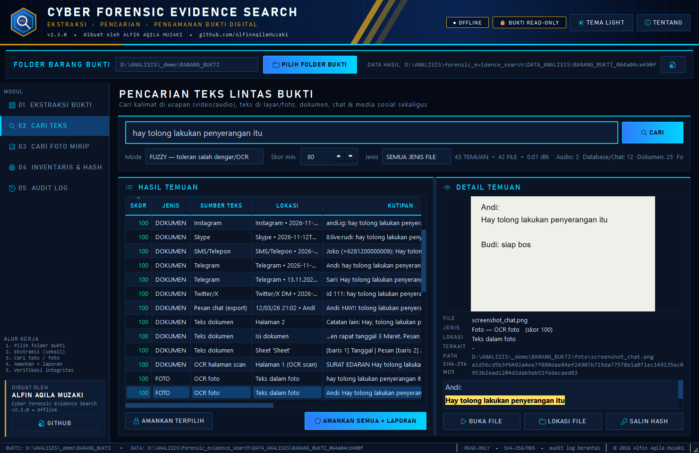

1. Ketik kalimat pada kolom pencarian, lalu tekan **CARI** atau Enter.
2. Pilih **Mode**:

   | Mode | Kapan dipakai | Contoh |
   |---|---|---|
   | **FUZZY** (default) | Hasil transkrip suara/OCR yang tidak sempurna | "hay tolong…" tetap menemukan *"Hey, to long lakukan…"* |
   | **FRASA PERSIS** | Mencari susunan kata yang tepat sama | dokumen/chat ketikan |
   | **SEMUA KATA** | Semua kata harus ada, urutan bebas | "transfer rekening bos" |

3. **Skor min.** (khusus Fuzzy, default 80): turunkan ke 70–75 untuk rekaman berkualitas
   rendah, naikkan ke 90 bila hasil terlalu banyak.
4. **Jenis:** batasi ke Video / Audio / Foto / Dokumen bila perlu.

Contoh hasil lintas media (video, audio, foto, dan dokumen sekaligus):

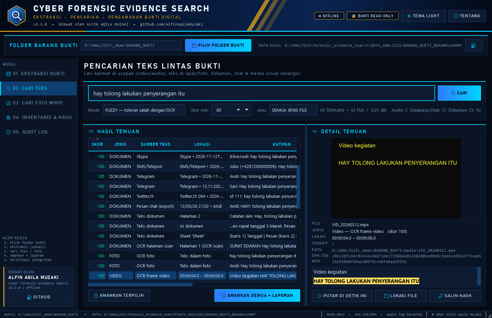

**Membaca tabel hasil:**

| Kolom | Arti |
|---|---|
| **SKOR** | 100 = cocok sempurna. Hijau ≥ 95, biru 85–94, oranye < 85 (perlu dicek lebih teliti) |
| **JENIS** | Video / Audio / Foto / Dokumen |
| **SUMBER TEKS** | *Transkrip suara*, *OCR frame video*, *OCR foto*, *Teks dokumen*, *OCR halaman scan* |
| **LOKASI** | Rentang waktu `jj:mm:dd.d – jj:mm:dd.d` (video/audio), atau Halaman / Slide / Sheet (dokumen) |
| **KUTIPAN** | Potongan teks di sekitar kalimat yang ditemukan |

Klik salah satu baris untuk melihat **Detail temuan**: pratinjau frame video atau
foto, nama file, path lengkap, SHA-256, MD5, dan teks lengkap dengan kalimat yang
ditemukan **ditandai kuning**.

Tombol di panel detail:
- **PUTAR DI DETIK INI**: memutar video/audio mulai 2 detik sebelum kalimat (memakai ffplay).
  Untuk foto/dokumen, tombol ini menjadi **BUKA FILE**.
- **LOKASI FILE**: membuka Windows Explorer di lokasi file asli.
- **SALIN HASH**: menyalin path + SHA-256 + MD5 ke clipboard.

Double-click pada baris sama dengan menekan PUTAR/BUKA.

### 8.4 Amankan bukti + buat laporan

Di bawah tabel hasil:
- **AMANKAN TERPILIH**: hanya baris yang dipilih (Ctrl/Shift + klik untuk memilih beberapa).
- **AMANKAN SEMUA + LAPORAN**: semua temuan.

Aplikasi membuat paket di `DATA_ANALISIS\<folder>\bukti_diamankan\<tanggal_jam>_<kalimat>\`,
lalu membuka laporannya secara otomatis. Laporan dibuat dalam dua format, **PDF** dan **HTML**:

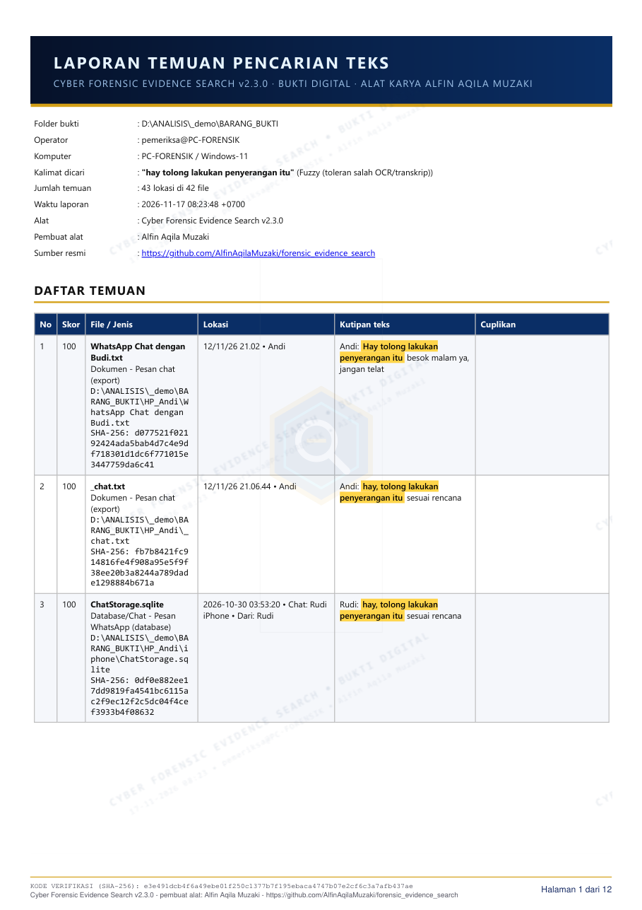

Pengamanan pada laporan:

| Elemen | Fungsi |
|---|---|
| **Watermark logo transparan** di tengah setiap halaman | Menandai dokumen sebagai keluaran resmi alat. Bila ada `logo.png` di folder aplikasi, logo itu yang dipakai |
| **Watermark teks miring berulang** (nama alat, waktu cetak, operator, pembuat alat) | Menyulitkan pemalsuan atau penggunaan potongan laporan di luar konteks |
| **Kode verifikasi SHA-256** di footer setiap halaman | Hash dari `manifest_hash.txt`. Siapa pun bisa menghitung ulang hash file itu untuk membuktikan laporan cocok dengan paket buktinya |
| **Nomor halaman** "Halaman x dari y" | Mencegah halaman hilang atau disisipkan tanpa terdeteksi |
| **Identitas alat & pembuat** (Alfin Aqila Muzaki + link GitHub) | Tercantum di header, metadata, dan footer laporan |
| **Metadata PDF** (author, creator, kode verifikasi) | Bisa dilihat di *Properties* file PDF |

> PDF dicetak otomatis memakai Microsoft Edge (bawaan Windows 10/11) atau Google Chrome
> dalam mode headless. Jika keduanya tidak ada, `laporan.html` tetap dibuat dan bisa
> dicetak ke PDF secara manual (Ctrl+P). Watermark ikut tercetak.

Isi paket bukti:

```
20261116_140351_hay_tolong_lakukan_penyerangan_itu/
├── laporan.pdf             laporan resmi ber-watermark, nomor halaman, kode verifikasi
├── laporan.html            versi HTML dari laporan yang sama (bisa dibuka di browser)
│                           identitas, kalimat dicari, daftar temuan (kutipan ber-highlight +
│                           cuplikan frame), tabel integritas, pembuat alat
├── hasil_pencarian.csv     data temuan untuk Excel
├── manifest_hash.txt       hash SHA-256/MD5 file asli + hash salinan + status COCOK
├── manifest_paket.sha256   hash setiap file di dalam paket
├── file_bukti/             salinan file asli (read-only, timestamp asli dipertahankan)
├── frame/                  cuplikan frame video tempat teks terdeteksi
└── teks/                   teks hasil ekstraksi lengkap per file (.txt)
```

Paket lama tidak pernah ditimpa. Setiap pengamanan membuat folder baru.

### 8.5 Cari foto mirip (modul 03)

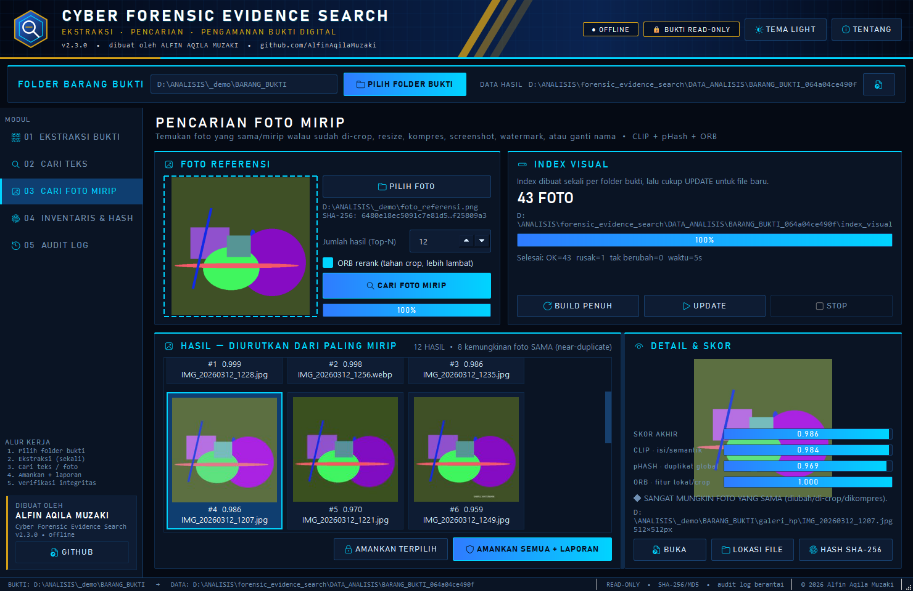

1. **Index visual:** tekan **BUILD PENUH** satu kali untuk folder bukti tersebut.
   Untuk file baru di kemudian hari cukup tekan **UPDATE**.
2. **Foto referensi:** tekan **PILIH FOTO** atau **seret foto** ke kotak bergaris.
   SHA-256 foto referensi ikut ditampilkan dan dicatat.
3. Atur **Jumlah hasil (Top-N)** dan **ORB rerank** (aktifkan untuk mendeteksi foto
   yang di-crop, walau sedikit lebih lambat).
4. Tekan **CARI FOTO MIRIP**. Hasil berupa grid foto yang diurutkan dari skor tertinggi.
5. Klik satu foto untuk melihat **Detail & Skor**:

   | Skor | Arti |
   |---|---|
   | **SKOR AKHIR** | Gabungan berbobot dari ketiga skor di bawah |
   | **CLIP** (isi/semantik) | Kemiripan isi/scene gambar |
   | **pHASH** (duplikat global) | Tinggi bila foto yang sama di-resize/dikompres/ganti format |
   | **ORB** (fitur lokal/crop) | Tinggi bila sebagian foto cocok, misalnya karena di-crop/di-screenshot |

   Penilaian otomatis:
   - ◆ **SANGAT MUNGKIN FOTO YANG SAMA**: pHash ≥ 0,85 atau ORB ≥ 0,6.
   - ◇ **Isi/scene sangat mirip**: CLIP tinggi, perlu dicek visual.
   - ○ **Mirip secara umum**: kandidat untuk pemeriksaan manual.
6. **AMANKAN TERPILIH / AMANKAN SEMUA + LAPORAN** menghasilkan paket bukti yang sama
   seperti pada 8.4. Paket ini menyertakan foto referensi beserta hash-nya, dan
   laporannya berisi rincian skor tiap foto.

### 8.6 Inventaris & hash (modul 04)

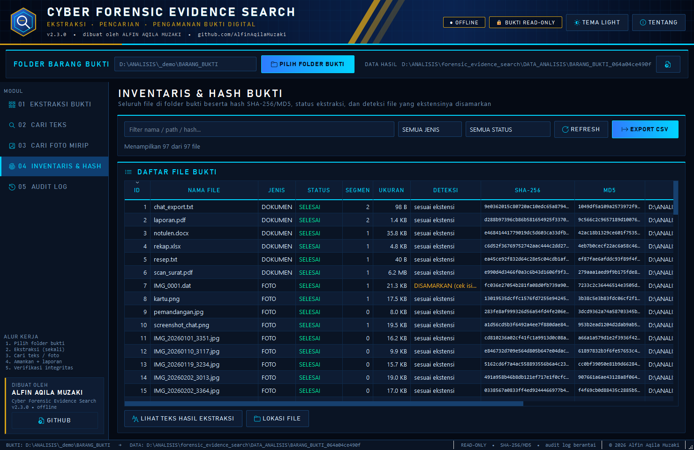

Menampilkan **seluruh file** di folder bukti: ID, nama, jenis, status
(SELESAI / ANTRIAN / GAGAL / HILANG), jumlah segmen teks, ukuran, cara deteksi
(*sesuai ekstensi* atau **DISAMARKAN**), SHA-256, MD5, path, dan keterangan error.

- Filter dengan kata kunci (nama/path/hash), jenis, atau status. Status
  **EKSTENSI DISAMARKAN** menampilkan file yang isinya tidak sesuai ekstensinya.
- **EXPORT CSV**: inventaris lengkap disimpan ke `DATA_ANALISIS\<folder>\laporan\`.
- **LIHAT TEKS HASIL EKSTRAKSI** (atau double-click): membuka file `.txt` berisi semua
  teks yang diekstrak dari file tersebut, lengkap dengan header path dan hash.

> Hash diisi saat file diproses oleh ekstraksi. File berstatus ANTRIAN belum memiliki hash.

### 8.7 Audit log & verifikasi (modul 05)

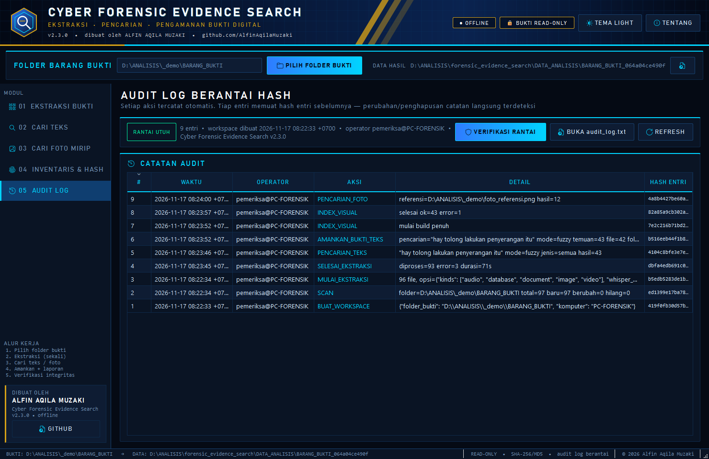

- Tabel berisi semua aksi: waktu, operator (`user@komputer`), jenis aksi
  (BUAT_WORKSPACE, SCAN, MULAI_EKSTRAKSI, PENCARIAN_TEKS, PENCARIAN_FOTO, INDEX_VISUAL,
  AMANKAN_BUKTI_TEKS/FOTO, VERIFIKASI_INTEGRITAS, EXPORT_INVENTARIS, …), detail, dan hash entri.
- **VERIFIKASI RANTAI**: memeriksa seluruh rantai hash. Hasilnya **RANTAI UTUH** atau
  **RANTAI RUSAK** (beserta nomor entri yang diubah).
- **BUKA audit_log.txt**: salinan teks audit log (append-only).

Di modul 01, **VERIFIKASI INTEGRITAS** menghitung ulang hash semua file bukti dan
melaporkan jumlah file yang cocok, berubah, dan hilang, sekaligus status rantai audit.

### 8.8 Bukti WhatsApp & aplikasi chat

Arahkan **folder bukti** ke folder hasil ekstraksi ponsel (hasil Cellebrite, Oxygen,
MOBILedit, Magnet AXIOM, Belkasoft, ADB backup, dll), lalu jalankan ekstraksi seperti biasa.
Pastikan **Database chat** tercentang di parameter ekstraksi. Aplikasi mengenali sendiri
jenis setiap file:

| Data dari ponsel | Yang dibaca aplikasi | Lokasi temuan di hasil pencarian |
|---|---|---|
| **Export chat** (`WhatsApp Chat dengan X.txt`, `_chat.txt`) format Android & iPhone | Setiap pesan (termasuk pesan multi-baris) | `12/11/26 21.02 • Andi` |
| **`msgstore.db`** WhatsApp Android (sudah didekripsi), skema baru & lama | Semua pesan teks, caption, dan pesan media. Nama kontak otomatis diambil dari **`wa.db`** bila ada di folder yang sama | `2026-11-12 21:01:00 • Chat: Budi • Dari: Saya (pemilik HP)` |
| **`ChatStorage.sqlite`** WhatsApp iPhone | Semua pesan teks, caption, dan pesan media, beserta nama chat/grup | `… • Chat: Rudi • Dari: Rudi` |
| **Media WhatsApp** (`WhatsApp Images/Video/Voice Notes/Documents`) | Foto di-OCR, video & voice note `.opus` ditranskrip, dokumen dibaca | Detik atau halaman |
| **Database SQLite aplikasi lain** (Telegram, LINE, catatan, browser, dll) | Semua kolom teks per baris tabel | `Tabel notes • baris 2` |
| **`msgstore.db.crypt14/15`** (masih terenkripsi) | Tidak bisa dibaca tanpa kunci. Ditandai **GAGAL** dengan keterangan "Database WhatsApp TERENKRIPSI" di Inventaris | — |

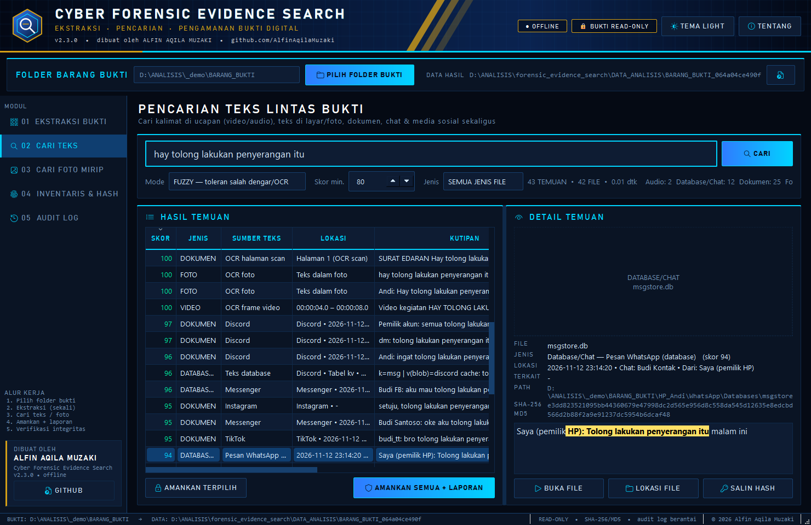

**Media terhubung dengan chat.** Bila pesan di database menyebut file media (misalnya voice
note `PTT-20261112-WA0003.opus`) dan file itu ada di folder bukti:
- Hasil pencarian **pesan chat** menampilkan baris **TERKAIT** berisi nama file media, dan
  tombol **BUKA FILE TERKAIT** langsung memutar atau membuka media itu.
- Hasil pencarian **voice note/foto/video** menampilkan baris **TERKAIT**:
  *"Dikirim di chat: 2026-11-12 23:15 • Chat: Budi • Dari: Budi"*.

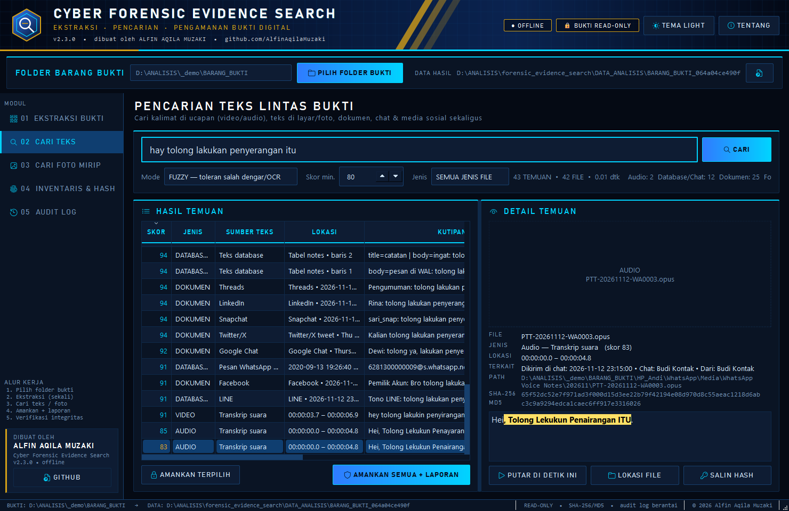

**Keamanan bukti database.** Database tidak pernah dibuka langsung dari folder bukti.
File `.db` beserta `-wal`/`-shm`/`-journal` disalin dulu ke folder sementara, lalu salinan
itu yang dibaca dan kemudian dihapus. Dengan cara ini:
- Folder bukti tidak tersentuh sama sekali. SQLite biasanya membuat file `-shm`/`-wal`
  saat membuka database, dan itu tidak terjadi di folder bukti.
- **Pesan yang masih tersimpan di file `-wal`** (belum dipindahkan ke database utama)
  **ikut terbaca**.

> Waktu pada pesan database ditampilkan dalam zona waktu komputer pemeriksa
> (dikonversi dari timestamp asli di database).

### 8.9 Media sosial & aplikasi pesan lain

Cara pakainya sama: masukkan data ke folder bukti, lalu jalankan ekstraksi. Aplikasi
**mengenali platformnya sendiri** dari isi dan struktur file. Kolom **SUMBER TEKS** di
hasil pencarian menunjukkan nama platformnya (Telegram, Instagram, Discord, dst), dan
kolom **LOKASI** berisi `Platform • waktu • Chat • Dari`.

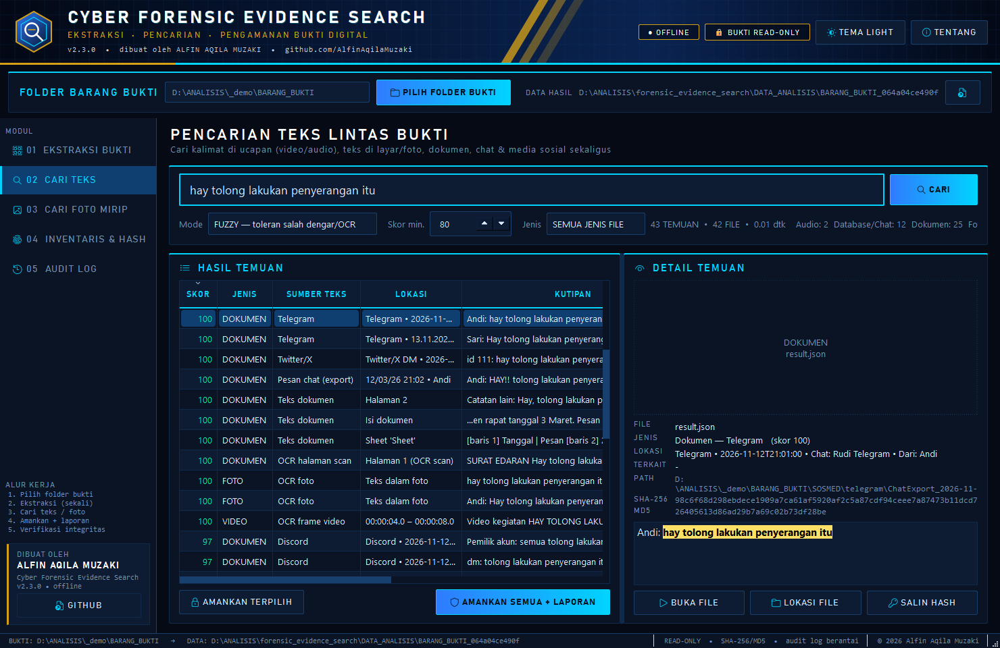

**A. Export akun** (data dari fitur "Download your information" / "Export chat" / arsip akun,
misalnya hasil permintaan data ke platform atau dari perangkat pemilik akun):

| Platform | File yang dibaca | Yang diekstrak |
|---|---|---|
| **Facebook & Messenger** | `messages/inbox/*/message_N.json`, export Messenger terenkripsi end-to-end (`*.json`) | Pesan per percakapan: pengirim, waktu, isi, tautan, foto/video/audio |
| **Instagram** | `your_instagram_activity/messages/inbox/*/message_N.json`, komentar, postingan | Pesan DM, komentar, caption |
| **Threads** | `threads/threads_and_replies.json` | Postingan & balasan |
| **Telegram** (Desktop) | `result.json` (format JSON) dan `messages.html` (format HTML) | Pesan per chat/grup: pengirim, waktu, isi, media |
| **Twitter / X** | arsip `data/tweets.js`, `direct-messages.js`, `like.js`, dll | Tweet, DM (dengan ID pengirim), like |
| **Discord** | data package `messages/c*/messages.json` atau `.csv` + `channel.json`; DiscordChatExporter (`.json`) | Pesan per server/channel/DM |
| **TikTok** | `user_data_tiktok.json` / `user_data.json` | Riwayat DM per lawan bicara |
| **Snapchat** | `json/chat_history.json` | Riwayat chat |
| **Skype** | `messages.json` | Pesan per percakapan |
| **Google Chat / Hangouts** | `Google Chat/Groups/*/messages.json` | Pesan per grup/DM |
| **LinkedIn** | `messages.csv` | Pesan per percakapan |
| **SMS & panggilan** | backup *SMS Backup & Restore* (`sms-*.xml`, `calls-*.xml`) | SMS, MMS, log panggilan (nomor, nama kontak, durasi) |

> Saat meminta/mengunduh data dari Facebook, Instagram, atau Threads, pilih format **JSON**
> (bukan HTML) agar pesan terbaca per pengirim dan waktu. Kesalahan encoding khas export
> Meta (emoji/huruf beraksen jadi karakter aneh) diperbaiki otomatis.

**B. Database aplikasi dari ekstraksi HP** (hasil Cellebrite, Oxygen, MOBILedit, AXIOM, dll):

| Aplikasi | File database | Yang diekstrak |
|---|---|---|
| WhatsApp | `msgstore.db` (+ `wa.db`), `ChatStorage.sqlite` | Lihat [8.8](#88-bukti-whatsapp--aplikasi-chat) |
| Telegram Android | `org.telegram.messenger/files/cache4.db` | Teks pesan (dari kolom biner), nama chat, waktu, pesan keluar/masuk |
| Facebook Messenger Android | `com.facebook.orca/databases/threads_db2` | Pesan, nama pengirim, waktu, percakapan |
| Instagram Android | `com.instagram.android/databases/direct.db` | Pesan DM, judul percakapan, waktu |
| LINE | `jp.naver.line.android/databases/naver_line` | Pesan, nama kontak, waktu |
| SMS Android | `com.android.providers.telephony/databases/mmssms.db` | SMS masuk/keluar |
| iMessage / SMS iPhone | `Library/SMS/sms.db` | Pesan (termasuk teks di `attributedBody` iOS terbaru), nomor, waktu |
| Aplikasi lain (Discord, TikTok, Snapchat, browser, dll) | database SQLite apa pun | Semua teks per baris tabel, termasuk teks di kolom biner. Nama aplikasi dikenali dari path folder |
| Signal, WeChat, Telegram iPhone | database terenkripsi SQLCipher | Tidak bisa dibaca tanpa kunci. Ditandai **GAGAL – TERENKRIPSI** di Inventaris |

---

## 9. Cara melihat & membaca hasil

Semua hasil tersimpan di folder aplikasi (tombol **BUKA FOLDER DATA** atau ikon folder di bar atas):

```
DATA_ANALISIS/
└── <nama-folder-bukti>_<hash-path>/
    ├── case.db              database: daftar file, hash, segmen teks + lokasi, audit
    ├── audit_log.txt        audit log berantai hash (teks)
    ├── hasil_ekstraksi/     000123_namafile.txt  → seluruh teks per file bukti
    ├── frame_bukti/         cuplikan frame video tempat teks terdeteksi
    ├── index_visual/        index pencarian foto mirip
    ├── bukti_diamankan/     paket bukti + laporan setiap pengamanan
    └── laporan/             export inventaris (CSV)
```

Contoh isi `hasil_ekstraksi\000014_VID_20260312.mp4.txt`:

```
=== HASIL EKSTRAKSI TEKS (FORENSIK DIGITAL) ===
File sumber : D:\uji\bukti\media\VID_20260312.mp4
Jenis       : Video (deteksi: ekstensi)
SHA-256     : c02c28fc64c02414e34871de17338b4d812682802e80b9c3ab4ce981d773cab6
...
[Transkrip suara | 00:00:03.7 - 00:00:06.9]
hey tolong lakukin penyirangan ITU.
[OCR frame video | 00:00:04.0 - 00:00:08.0]
Video kegiatan
HAY TOLONG LAKUKAN PENYERANGAN ITU
```

**Pedoman membaca hasil:**
- Skor **100** pada *Teks dokumen* berarti teks persis tertulis di dokumen.
- Pada **Transkrip suara** dan **OCR**, teks adalah hasil pengenalan mesin. Ejaan bisa
  sedikit berbeda dari ucapan/tulisan aslinya, dan itulah alasan mode Fuzzy dibuat.
  **Setiap temuan wajib diverifikasi** dengan memutar/membuka file asli pada lokasi
  yang ditunjukkan (tombol PUTAR DI DETIK INI).
- Pada video, kalimat yang sama bisa muncul dua kali: dari **suara** dan dari **teks di layar**.
  Keduanya ditampilkan sebagai temuan terpisah.

---

## 10. Kinerja & skala (hasil pengukuran)

Diukur pada laptop Windows 11, CPU 12 thread, tanpa GPU:

| Pengujian | Hasil |
|---|---|
| 3.000 file dokumen: scan + hash + ekstraksi + simpan | **13 ms/file** (± 40 detik total) |
| Menjalankan ulang tanpa ada file berubah (incremental) | **0,1 detik** |
| Pencarian FUZZY pada **500.000 segmen teks** (setara ribuan video/audio) | **± 4 detik**, 25/25 kalimat uji ditemukan |
| Pencarian FRASA PERSIS pada 500.000 segmen | **0,2 detik** |
| 1.144 screenshot (pengujian nyata) | OCR ± 1 detik/foto, index foto mirip 63 detik |

Perkiraan waktu ekstraksi media (CPU):

| Jenis | Perkiraan |
|---|---|
| Dokumen | sangat cepat (milidetik per file) |
| Foto / screenshot | ± 1–3 detik per foto |
| Audio | ± 0,3–1 × durasi (model `small`), lebih cepat dengan `base` |
| Video | transkrip suara + OCR frame. Video panjang sebaiknya memakai interval frame lebih besar |

**Saran untuk ribuan file media:** jalankan ekstraksi di akhir hari dan biarkan berjalan
semalaman. Proses aman dihentikan dan dilanjutkan kapan saja.

---

## 11. Tema tampilan

Tersedia dua tema: **Dark** dan **Light**. Ganti dengan tombol **TEMA LIGHT / TEMA DARK**
di kanan atas. Pilihan tema diingat untuk pemakaian berikutnya.

| Dark | Light |
|---|---|
|  | 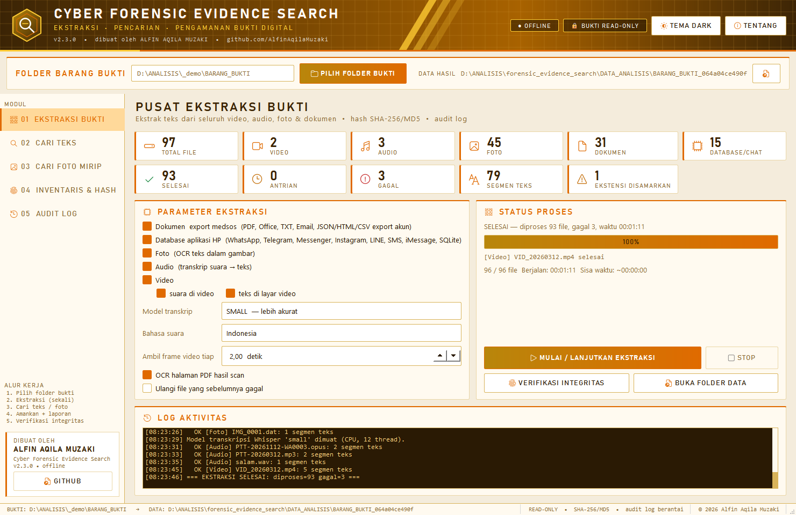 |
|  | 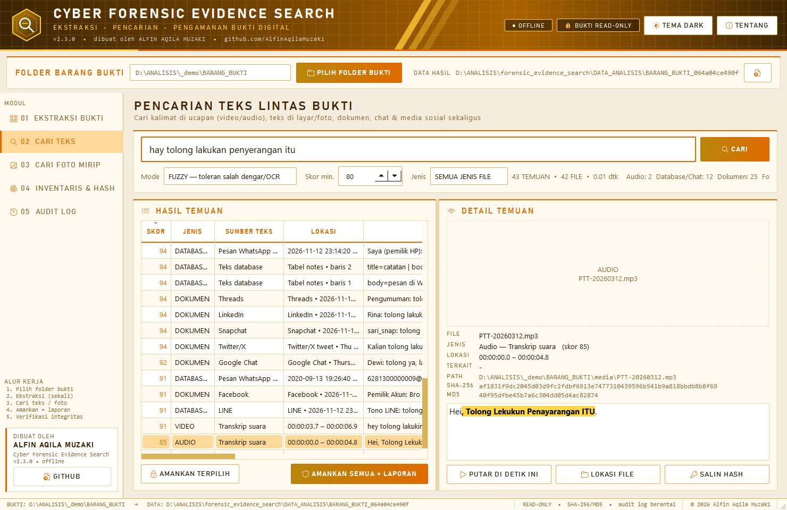 |
|  | 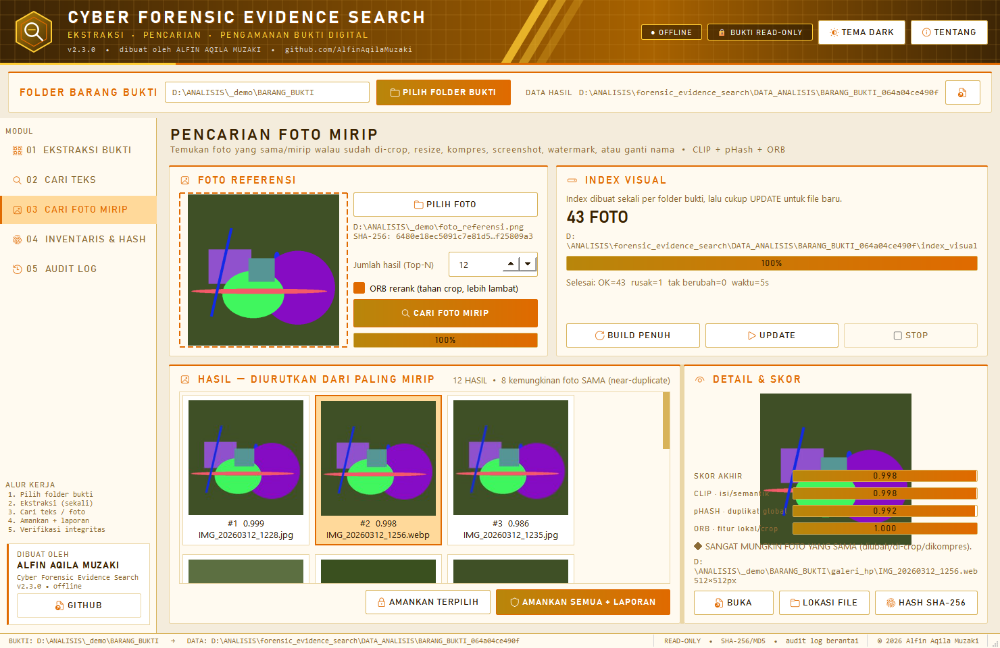 |

Nama pembuat (**Alfin Aqila Muzaki**) tampil di header, panel kiri (beserta tombol
**GITHUB**), judul jendela, dan status bar. Tombol **TENTANG** di kanan atas
menampilkan versi, pembuat, dan link sumber resmi.

Logo instansi bisa ditampilkan di header: letakkan file **`logo.png`** (disarankan
persegi, minimal 128×128 px) di folder aplikasi, lalu jalankan ulang aplikasi.

---

## 12. Membuat versi EXE & installer (untuk developer)

Bagian ini untuk **pengembang** yang ingin membuat ulang installer. Pengguna biasa cukup
mengunduh installer jadi (lihat [Download & Instal](#️-download--instal--langsung-pakai-tanpa-python)).

Di komputer yang sudah menyelesaikan Langkah 1–7:

**1. Build EXE**
```powershell
build_exe.bat
```
- Membungkus aplikasi, Python, semua library, model AI, FFmpeg, dan ikon menjadi folder
  `dist\ForensicEvidenceSearch\` (± 3–4 GB). Proses 10–40 menit.
- Build memakai virtual environment terpisah (`.venv_build`), dan file sementaranya
  disimpan di folder project (`_tmp_build`), bukan di drive C.
- Di akhir proses, `ForensicEvidenceSearch.exe --selftest` dijalankan otomatis. Self-test
  memeriksa folder data, FFmpeg, browser PDF, CLIP, EasyOCR, dan Whisper. Semua baris
  harus `[OK]` dan diakhiri `SELFTEST PASSED`.
- Pesan *WARNING* tentang `pytest`, `dask`, `tensorboard`, dan *DeprecationWarning* torch normal.

**2. Buat installer `Setup.exe`**
```powershell
winget install JRSoftware.InnoSetup     # sekali saja
build_installer.bat
```
- Hasil di `installer_output\`: `CyberForensicEvidenceSearch-Setup-v<versi>.exe` (± 4 MB)
  dan file `.bin` (± 1,6 GB; dipecah otomatis bila > 2 GB).
- Installer berbahasa Indonesia, bisa dipasang tanpa hak administrator, membuat ikon
  Desktop dan menu Start, dan terdaftar di *Settings → Apps* untuk uninstall.
- Konfigurasi installer ada di `installer\ForensicEvidenceSearch.iss`.

**3. Rilis di GitHub**: upload **semua** file di `installer_output\` ke satu GitHub Release.
```powershell
gh release create v<versi> installer_output\* --title "Cyber Forensic Evidence Search v<versi>"
```

Folder `dist\ForensicEvidenceSearch\` juga bisa langsung di-copy ke komputer lain dan
dijalankan dengan double-click `ForensicEvidenceSearch.exe` (versi portable tanpa installer).

---

## 13. Pengujian

| Perintah | Yang diuji |
|---|---|
| `python tests\make_forensic_dataset.py <folder>` | Membuat data uji: kalimat target di DOCX, PDF, PDF scan, TXT, XLSX, screenshot, foto berekstensi palsu, voice note MP3, video (teks di layar + suara), plus file pengecoh |
| `python tests\make_whatsapp_dataset.py <folder>` + `python tests\validate_whatsapp.py <folder> <hasil> [base\|small]` | Export chat Android/iPhone, `msgstore.db` skema baru & lama + kontak `wa.db`, `ChatStorage.sqlite`, SQLite umum, **isi file `-wal`**, voice note `.opus` terhubung ke chat, `.crypt15` terdeteksi, dan folder bukti tidak berubah (15 pemeriksaan; jalankan dengan model `small`) |
| `python tests\make_social_dataset.py <folder>` + `python tests\validate_social.py <folder> <hasil>` | 25 sumber dari 15 platform (export akun & database HP), perbaikan encoding Meta, Signal terenkripsi terdeteksi, file pengecoh tidak muncul, folder bukti tidak berubah |
| `python tests\validate_forensic.py <bukti> <hasil> [base\|small]` | Ekstraksi end-to-end, ketiga mode pencarian, deteksi false positive, pengamanan bukti, verifikasi hash, dan **memastikan folder bukti tidak berubah** |
| `python tests\scale_test.py <folder> 3000 500000` | Uji skala: ribuan file nyata + ratusan ribu segmen teks |
| `python tests\validate.py` | Validasi modul foto mirip (8 varian near-duplicate vs 40 distractor) |
| `python main.py --selftest` | Semua mesin siap offline: folder data, FFmpeg, browser PDF, CLIP, EasyOCR, Whisper |

Hasil validasi terakhir: **9/9 file target ditemukan, 0 false positive, folder bukti
tidak berubah, verifikasi hash 14/14 cocok, rantai audit utuh → `HASIL: LULUS`.**

---

## 14. Struktur project

```
forensic_evidence_search/
├── main.py                     entry point (GUI) + --selftest
├── jalankan.bat                menjalankan aplikasi dari source
├── build_exe.bat               build EXE (dist\ForensicEvidenceSearch\) + self-test otomatis
├── build_installer.bat         membuat installer Setup.exe (Inno Setup)
├── installer/                  skrip installer (ForensicEvidenceSearch.iss)
├── assets/                     ikon aplikasi (app.ico)
├── hapus_semua_data.bat        menghapus seluruh DATA_ANALISIS
├── requirements.txt
├── dokumentasi/                screenshot dokumentasi README
├── models/                     model AI offline (diunduh, tidak ada di GitHub)
├── scripts/download_model.py   pengunduh semua model
├── app/
│   ├── gui.py                  jendela utama: header, bar folder bukti, navigasi
│   ├── workspace.py            lokasi data hasil otomatis per folder bukti
│   ├── ui/                     tampilan: tema, komponen, halaman 01–05
│   ├── forensic/               modul forensik teks
│   │   ├── extractors.py       dokumen, OCR, transkrip suara, frame video, hash, signature
│   │   ├── pipeline.py         scan → hash → ekstraksi → simpan, verifikasi integritas
│   │   ├── store.py            database & audit log berantai hash
│   │   ├── search.py           pencarian fuzzy / frasa / semua kata
│   │   └── report.py           pengamanan bukti & laporan HTML/CSV
│   └── (config, indexer, search, embedding, hashing, rerank, …)  modul foto mirip
└── tests/                      pembuat data uji & skrip validasi
```

---

## 15. Pemecahan masalah (FAQ)

**`ffmpeg tidak ditemukan` / video & audio gagal diproses**
Install FFmpeg (Langkah 3), lalu buka ulang terminal. Atau taruh `ffmpeg.exe`,
`ffprobe.exe`, dan `ffplay.exe` di folder `bin\` aplikasi.

**`Model OCR ... tidak tersedia offline` / `Model Whisper ... tidak ada offline`**
Jalankan `python scripts\download_model.py` (butuh internet sekali).

**Tombol PUTAR DI DETIK INI hanya membuka file dari awal**
`ffplay.exe` belum ada. Install FFmpeg versi lengkap (berisi ffplay) atau salin ke `bin\`.

**Pencarian tidak menemukan kalimat yang seharusnya ada**
1. Pastikan ekstraksi file tersebut sudah **SELESAI** (cek modul 04).
2. Gunakan mode **FUZZY** dan turunkan **Skor min.** ke 70.
3. Cari potongan kalimat yang lebih khas (contoh: `penyerangan itu`).
4. Untuk rekaman suara, ekstraksi ulang dengan model **SMALL** dan bahasa yang tepat.

**Banyak file berstatus GAGAL/CRASH**
Lihat kolom *Keterangan* di modul 04. File rusak/terpotong memang tidak bisa dibaca.
Centang **Ulangi file yang sebelumnya gagal** untuk mencoba lagi.

**Proses terasa lambat**
Pilih model **BASE**, perbesar interval frame video, atau proses per jenis file
(contoh: dokumen & foto dulu, video belakangan). GPU NVIDIA dengan PyTorch CUDA
mempercepat OCR dan foto mirip.

**Konflik versi library dengan tool lain (misalnya volatility3)**
Gunakan virtual environment (Langkah 5) agar library aplikasi ini terpisah.

**Menghapus semua data hasil analisis**
Jalankan `hapus_semua_data.bat` (perlu konfirmasi `YES`). Folder bukti asli tidak
tersentuh. **Arsipkan paket `bukti_diamankan` terlebih dahulu bila masih dibutuhkan.**

---

## 16. Batasan yang perlu diketahui

- Transkrip suara dan OCR adalah **pengenalan otomatis**: akurasinya dipengaruhi kualitas
  rekaman (bising, logat, musik latar) dan kualitas gambar (blur, huruf kecil, tulisan
  tangan). Hasil aplikasi adalah **alat bantu penemuan**, dan verifikasi akhir tetap
  dilakukan pemeriksa dengan melihat/mendengar file asli.
- Teks di layar yang muncul lebih singkat dari interval frame bisa terlewat. Perkecil
  interval bila perlu.
- File arsip (ZIP/RAR/TAR) belum dibongkar otomatis. Ekstrak terlebih dahulu, lalu
  arahkan aplikasi ke folder hasilnya.
- Database WhatsApp terenkripsi (`.crypt12/14/15`) harus didekripsi dulu dengan kuncinya
  (file `key` dari ponsel) memakai tool forensik. Setelah itu analisis `msgstore.db`
  hasil dekripsinya.
- Database aplikasi yang belum punya pembaca khusus dibaca secara umum (semua teks per
  baris tabel), tanpa penamaan pengirim/chat. Pembacaan dibatasi 200.000 baris per tabel.
- Signal, WeChat, dan Telegram iPhone mengenkripsi database-nya (SQLCipher), sehingga harus
  didekripsi dulu dengan tool forensik yang memiliki kuncinya.
- Struktur export dan database media sosial bisa berubah ketika platform memperbarui
  aplikasinya. Pembaca di aplikasi ini mengikuti struktur yang umum dipakai. Jika suatu
  versi tidak terbaca dengan rapi, isinya tetap bisa dicari lewat pembaca umum.
- Skor kemiripan foto **bukan** bukti identik, hanya untuk mengurutkan kandidat.
- HEIC/HEIF butuh plugin tambahan (`pillow-heif`).

---

## 17. Lampiran: cara kerja teknis

### 17.1 Pencarian teks

1. **Ekstraksi:** dokumen dibaca langsung (PyMuPDF, python-docx, python-pptx, openpyxl).
   Foto dan frame video di-OCR (EasyOCR, urutan baca per baris). Suara ditranskrip
   (faster-whisper, int8, dengan VAD untuk melewati bagian hening). Frame video
   diambil oleh FFmpeg tiap N detik. Frame yang tidak berubah dan teks yang sama
   berturut-turut digabung menjadi satu segmen dengan rentang waktu.
2. **Penyimpanan:** setiap potongan teks (*segmen*) disimpan beserta sumber, rentang
   waktu/halaman, dan versi ternormalisasi (huruf kecil, tanpa tanda baca/aksen).
3. **Pencarian:** kalimat dicari pada setiap segmen **dan** gabungan dua segmen
   berurutan (untuk kalimat yang terpotong di batas segmen transkrip).
   Mode fuzzy memakai *partial ratio* (RapidFuzz, multi-thread) dengan dua cara
   perbandingan: per kata dan tanpa spasi. Cara kedua menangani kata yang dipecah
   atau digabung oleh transkrip, misalnya "to long" = "tolong". Segmen yang lebih
   pendek dari kalimat dinilai dengan rasio penuh untuk mencegah false positive.

### 17.2 Pencarian foto mirip


#### 1. Model embedding yang digunakan dan alasannya

**CLIP ViT-B/32 (pretrained "openai") via `open_clip`** (`app/embedding.py`).

CLIP adalah vision-language encoder yang dilatih agar representasi visual
sebuah gambar (vector 512 dimensi) menangkap ISI gambar itu -- objek, scene,
komposisi, warna, tekstur -- terlepas dari nama file, format, atau metadata
apa pun, karena input model murni piksel gambar. ViT-B/32 dipilih sebagai
default karena rasio kecepatan/akurasi terbaik untuk memproses ~200.000
gambar di CPU dalam waktu wajar. Bisa diganti ke model lebih besar (mis.
`ViT-L-14`) di `app/config.py` bila tersedia GPU dan akurasi semantik lebih
diprioritaskan daripada kecepatan indexing.

Model **tidak** melakukan face recognition dan tidak pernah menerima input
selain array piksel gambar.

#### 2. Bagaimana vector dibuat dari gambar

1. Gambar dibuka (`utils.safe_open_image`), dikonversi ke RGB.
2. Di-preprocess oleh transform bawaan CLIP (resize ke 224x224, normalisasi
   channel) -- transform yang identik dipakai saat indexing maupun saat
   query, supaya representasi konsisten.
3. Forward pass lewat encoder visual CLIP menghasilkan vector 512 dimensi.
4. Vector di-**L2-normalize**, sehingga `cosine_similarity(a, b) == dot(a, b)`.
   Ini penting supaya FAISS bisa memakai metric `INNER_PRODUCT` yang jauh
   lebih murah dihitung daripada cosine similarity biasa.

#### 3. Bagaimana FAISS/HNSW menyimpan dan mencari vector

`app/vector_index.py` membungkus `faiss.IndexHNSWFlat` (metric
`INNER_PRODUCT`) di dalam `IndexIDMap2`, dengan **id FAISS == id baris
SQLite** (jadi tidak perlu tabel mapping index-row terpisah).

HNSW (Hierarchical Navigable Small World) membangun graf multi-layer di
mana tiap vector terhubung ke tetangga-tetangga terdekatnya. Saat query,
pencarian dimulai dari layer paling jarang (global) lalu turun ke layer
lebih padat (lokal), sehingga nearest-neighbor search jauh lebih cepat
daripada membandingkan brute-force ke semua 200.000 vector, dengan recall
mendekati exact search jika parameter (`efConstruction`, `efSearch`) cukup
tinggi (lihat `app/config.py`). HNSW dipilih dibanding IVF/PQ karena tidak
butuh fase "training" dan pada skala 200k x 512-float32 (~400 MB) index
flat masih muat nyaman di RAM tanpa perlu kompresi vector (PQ) yang bisa
menurunkan akurasi.

FAISS index disimpan sebagai satu file (`vectors.hnsw`) terpisah dari
gambar aslinya; ditambah (`index.add_with_ids`) secara incremental setiap
kali ada gambar baru diproses.

#### 4. Bagaimana sistem menangani crop, screenshot, resize, dan compression

Sistem TIDAK bergantung pada satu sinyal saja. Tiga sinyal digabung:

| Sinyal | Modul | Tahan terhadap | Lemah terhadap |
|---|---|---|---|
| CLIP embedding (semantic) | `embedding.py` | resize, compress, watermark kecil, brightness/kontras, screenshot (scene masih dominan sama) | crop besar (isi visual dominan berubah) |
| Perceptual hash pHash/dHash | `hashing.py` | resize, compress ulang, format berbeda, watermark kecil | crop, rotasi, screenshot dengan frame besar |
| ORB local feature matching + RANSAC homography | `rerank.py` | **crop**, rotasi, scaling parsial, screenshot (karena mencocokkan fitur lokal, bukan gambar utuh) | gambar low-detail/flat (sedikit fitur lokal) |

Alur pencarian (`app/search.py`):

1. Query di-hash (pHash/dHash) dan di-embed (CLIP).
2. Kandidat awal diambil dari **dua jalur paralel**: FAISS ANN search
   (top-K berdasar cosine similarity) DAN Hamming-distance search atas
   seluruh pHash di database (top-K berdasar jarak Hamming). Ini penting:
   kompresi berat/screenshot kadang membuat CLIP similarity turun sedikit
   tapi pHash tetap sangat dekat, atau sebaliknya.
3. Kandidat digabung (union), skor awal (`clip_sim`, `phash_sim` eksak --
   `clip_sim` direkonstruksi langsung dari FAISS bila kandidat tidak
   berasal dari jalur CLIP) dipakai untuk memilih pool kandidat yang akan
   di-rerank (`RERANK_POOL_SIZE`, default 400 -- bukan seluruh 200.000,
   supaya tetap cepat).
4. Pool tersebut di-rerank dengan **ORB + RANSAC homography**
   (`rerank.orb_match_score`): mencari titik fitur lokal yang cocok antara
   query dan kandidat, lalu memverifikasi kecocokan itu secara geometris.
   Inilah yang menangkap kasus **crop** signifikan, karena walau komposisi
   global berubah, sebagian struktur lokal (tepi, tekstur, pola) tetap
   sama dan bisa dicocokkan.
5. Skor akhir = kombinasi berbobot `WEIGHT_CLIP * clip_sim + WEIGHT_PHASH *
   phash_sim + WEIGHT_ORB * orb_score` (default 0.5/0.2/0.3, bisa diubah di
   `app/config.py`).

#### 5. Perbedaan "identical/near-duplicate image matching" vs "semantic visual similarity"

- **Near-duplicate matching**: mendeteksi bahwa dua file, walau berbeda
  secara byte (format/kompresi/ukuran/crop berbeda), sebenarnya berasal
  dari sumber visual yang sama. Ditangani terutama oleh pHash (global,
  cepat, cocok untuk resize/compress) dan ORB+RANSAC (lokal, cocok untuk
  crop/rotasi). Skornya cenderung sangat tinggi (>0.8-0.9 pada skala 0-1).
- **Semantic visual similarity**: dua gambar berbeda (bukan hasil modifikasi
  satu sama lain) tapi punya scene/komposisi/objek yang mirip (mis. dua
  foto pantai berbeda). Ditangani oleh CLIP embedding. Skornya biasanya
  lebih rendah dan lebih halus (graded), berguna untuk memunculkan kandidat
  tambahan yang layak diperiksa manual, bukan sebagai bukti gambar sama.

Aplikasi ini SENGAJA menampilkan breakdown ketiga skor (`clip`, `phash`,
`orb`) di UI supaya pengguna bisa membedakan kedua kasus di atas, bukan
hanya melihat satu angka gabungan.

#### 6. Bagaimana menghindari false positive

- Similarity score **tidak pernah** diperlakukan sebagai bukti dua gambar
  identik -- hanya untuk mengurutkan. Verifikasi visual akhir tetap di
  tangan pengguna (lihat kolom score + tampilan thumbnail berdampingan).
- Kombinasi 3 sinyal independen (semantic, global-hash, local-feature)
  jauh lebih tahan false positive dibanding satu metode saja: kandidat yang
  tinggi di CLIP tapi rendah di pHash & ORB kemungkinan besar hanya "scene
  mirip", bukan gambar yang sama.
- ORB+RANSAC secara eksplisit memverifikasi kecocokan geometris (bukan
  cuma "banyak fitur mirip") sehingga menyaring kecocokan fitur lokal yang
  kebetulan (coincidental matches) yang tidak membentuk transformasi
  konsisten.
- pHash yang dipakai berukuran besar (16x16 -> 256-bit, lihat
  `PHASH_SIZE`), lebih diskriminatif daripada pHash default 64-bit sehingga
  mengurangi tabrakan (dua gambar berbeda kebetulan dapat hash yang sama).
- Metadata, nama file, EXIF, dan timestamp **tidak pernah** dipakai sebagai
  sinyal similarity di mana pun dalam pipeline -- hanya dipakai untuk
  keperluan administratif incremental indexing (deteksi file baru/berubah
  berdasar size+mtime), sama sekali tidak memengaruhi skor kemiripan.

---

## 18. Pembuat & sumber resmi

| | |
|---|---|
| **Pembuat** | **Alfin Aqila Muzaki** |
| **Repository resmi** | <https://github.com/AlfinAqilaMuzaki/forensic_evidence_search> |
| **Versi** | 2.3.0 |

Cyber Forensic Evidence Search dirancang dan dikembangkan oleh **Alfin Aqila Muzaki**.
Identitas pembuat dan alamat repository resmi ikut tercantum di aplikasi, di setiap
laporan PDF/HTML, di manifest hash, dan di file teks hasil ekstraksi. Dengan begitu,
asal-usul alat yang dipakai untuk menghasilkan suatu laporan bukti selalu bisa ditelusuri.

Unduh aplikasi hanya dari repository resmi di atas. Laporan, saran, atau pertanyaan
silakan disampaikan melalui menu **Issues** di repository tersebut.

---

*Cyber Forensic Evidence Search v2.3.0 — dibuat oleh Alfin Aqila Muzaki —
<https://github.com/AlfinAqilaMuzaki/forensic_evidence_search>. Alat bantu forensik
digital; hasil pengenalan otomatis wajib diverifikasi oleh pemeriksa.*
